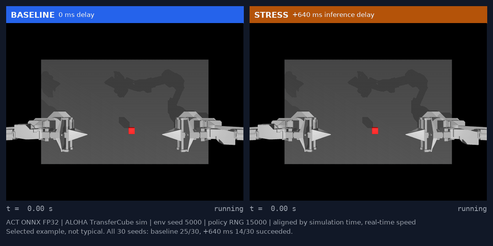

# Breakpoint

Breakpoint measures how a pretrained robot policy's task success changes when simulated delay, camera quality, or numeric precision degrade, using paired seeds and reported uncertainty.



*Selected example (env seed 5000), not a typical episode: the same ACT policy and seed with no added delay (success at 5.68 s) and with +640 ms inference delay (timeout at 8.00 s). Across all 30 seeds the baseline succeeded 25 times and the +640 ms condition 14 times. Real simulation footage; no physical robot. [MP4](benchmarks/act-transfer/v1/media/comparison.mp4)*

[Try the example](#try-the-example) · [Reproduce](benchmarks/act-transfer/v1/REPRODUCE.md) · [Methodology](benchmarks/act-transfer/v1/METHODOLOGY.md)

## Results

v0.1, exploratory. One task: ALOHA TransferCube simulation, pretrained ACT policy
`lerobot/act_aloha_sim_transfer_cube_human`, ONNX Runtime on CPU. One stress axis changes at a
time; each condition is 30 paired episodes (env seeds 5000 to 5029). Entries are successes out of 30.

| Stress | Conditions and successes |
| --- | --- |
| Constant added delay | 0 ms: 25, 40 ms: 25, 80 ms: 25, 160 ms: 23, 320 ms: 18, 640 ms: 14 |
| Camera resolution | 480x640 native: 25, 240x320: 26, 120x160: 22, 60x80: 10 |
| JPEG quality | bypass: 25, q95: 25, q75: 26, q50: 26, q25: 25, q10: 23 |
| Precision | FP32: 25, static QDQ INT8: 24 |
| Device latency replay | laptop M3: 24, Raspberry Pi 5: 9 (Pi was throttling while profiled) |

The baseline is 25/30 (83.3%, Wilson 95% interval 66.4% to 92.7%). With a threshold of 0.8 times
the baseline, the point estimate first falls below it at 320 ms, at 60x80, and under the Pi 5
replay; no JPEG quality or the INT8 graph fell below it. These are observed points, not exact
boundaries, and the 320 ms interval includes the threshold. The [full report](benchmarks/act-transfer/v1/report/index.html)
has intervals, a per-seed paired outcome matrix, latency traces, and provenance.

## Try the example

Renders the saved results with only the report dependencies. No simulator, Torch, network access,
or model download.

```bash
python3.11 -m venv .venv
.venv/bin/python -m pip install -e '.[report]'
.venv/bin/python scripts/render_v1.py \
  --input benchmarks/act-transfer/v1/data --out /tmp/breakpoint-report
```

Then open `/tmp/breakpoint-report/index.html`.

## Supported scope

- One task and policy (above), validated ONNX FP32 export, and one static QDQ INT8 comparison.
- Synthetic constant delay, resolution, and JPEG stress; latency replay from measured laptop and
  Raspberry Pi 5 FP32 profiles.
- Tested on macOS 14 arm64 with Python 3.11 and CPU execution. Evidence and pins:
  [docs/compatibility.md](docs/compatibility.md).

## Installation

Install from a checkout; there is no package index release.

| Goal | Command |
| --- | --- |
| Report only | `pip install -e '.[report]'` |
| Pi or edge ONNX profiling | `pip install -r requirements-pi-profile.txt && pip install -e '.[onnx]'` |
| Simulator runs (macOS) | see [docs/compatibility.md](docs/compatibility.md) |

## Limitations

- Simulation only. Nothing here is a guarantee about a physical robot or deployment.
- Thirty episodes per condition give wide intervals; the run is exploratory and fresh-seed
  confirmation has not been done.
- The Pi 5 profile was captured under reported thermal throttling with cooling and power not
  recorded.
- INT8 is a static QDQ graph, not a full-model INT8 claim, and was not required to match FP32
  numerically.
- Not covered: other tasks, other policies, H.264, and any claim that these thresholds transfer to
  another setup.
- About 390 MB of raw control-step logs are kept locally, not in the repository; hashes are in
  [`large_evidence.json`](benchmarks/act-transfer/v1/data/large_evidence.json).
