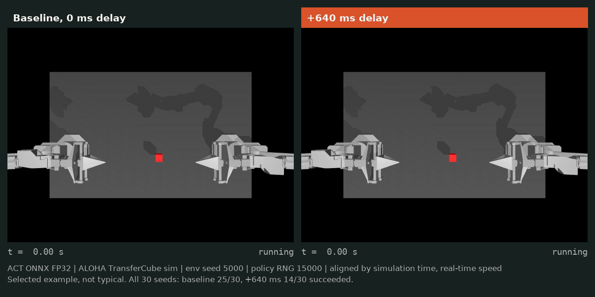

# Breakpoint

Breakpoint measures how inference delay, camera quality, and quantization affect a robot policy's success in simulation. It runs a pretrained ACT policy on the ALOHA TransferCube task with paired seeds and reports uncertainty for each condition.



*Selected example (env seed 5000), not a typical episode. The same ACT policy and seed with no added delay (left, success at 5.68 s) and with +640 ms inference delay (right, timeout at 8.00 s). Across all 30 seeds the baseline succeeded 25 times and the +640 ms condition 14 times. Simulation footage, no physical robot. [MP4](benchmarks/act-transfer/deployment-stress/media/comparison.mp4) (0.4 MB, an alternative to this 3.3 MB GIF) · [selection and frame details](benchmarks/act-transfer/deployment-stress/README.md#comparison-media)*

## Render the saved report

Needs Python 3.11 and network access for the install. Rendering itself is offline and needs no simulator, Torch or model download. Run from a clone:

```bash
git clone https://github.com/mert-ogul/breakpoint.git
cd breakpoint
python3.11 -m venv .venv
.venv/bin/python -m pip install -e '.[report]'
.venv/bin/python scripts/render_benchmark.py \
  --input benchmarks/act-transfer/deployment-stress/data --out /tmp/breakpoint-report
```

Open `/tmp/breakpoint-report/index.html`. The renderer checks the saved files against their SHA-256 manifest and recomputes every count and interval before it writes anything. The committed report is at [`report/report.md`](benchmarks/act-transfer/deployment-stress/report/report.md); `index.html` in the same directory is the interactive version and needs a local browser.

## Results

Pretrained policy `lerobot/act_aloha_sim_transfer_cube_human`, ONNX Runtime on CPU. One stress axis changes at a time. Each condition is 30 paired episodes (env seeds 5000 to 5029). Entries are successes. The table is generated by `scripts/render_benchmark.py --update-readme README.md`.

<!-- results:start (generated by scripts/render_benchmark.py --update-readme) -->
| Stress | Conditions and successes (of 30) |
| --- | --- |
| Constant added delay | 0 ms: 25, 40 ms: 25, 80 ms: 25, 160 ms: 23, 320 ms: 18, 640 ms: 14 |
| Camera resolution | 480x640 native: 25, 240x320: 26, 120x160: 22, 60x80: 10 |
| JPEG quality | bypass: 25, q95: 25, q75: 26, q50: 26, q25: 25, q10: 23 |
| Numeric precision | FP32: 25, INT8 QDQ: 24 |
| Device latency replay | laptop-m3 replay: 24, rpi5 replay: 9 |

- Baseline (ONNX FP32, native image, 0 ms delay): 25/30 (83.3%; Wilson 95% 66.4% to 92.7%).
- Constant added delay: first grid point below 0.8 x baseline is 320 ms at 18/30 (interval includes threshold).
- Camera resolution: first grid point below 0.8 x baseline is 60x80 at 10/30.
- JPEG quality: no condition fell below 0.8 x baseline.
- Numeric precision (categorical comparison, no ordering) against 0.8 x baseline: INT8 QDQ 24/30 not below.
- Device latency replay (categorical comparison, no ordering) against 0.8 x baseline: laptop-m3 replay 24/30 not below; rpi5 replay 9/30 below.
<!-- results:end -->

These are observed grid points, not exact boundaries. The [full report](benchmarks/act-transfer/deployment-stress/report/report.md) has intervals, per-seed paired outcomes, latency traces and provenance. Evidence layout and result-specific limitations are in the [benchmark README](benchmarks/act-transfer/deployment-stress/README.md).

## Supported scope

- One task and policy, a validated ONNX FP32 export, and one static QDQ INT8 comparison.
- Constant added delay, camera resolution and JPEG quality. Latency replay uses recorded FP32 CPU profiles from a laptop (Apple M3) and a Raspberry Pi 5.
- Evidence comes from macOS 14.6 arm64 with Python 3.11 on CPU. The Pi profile was recorded on Linux aarch64. Other platforms are untested ([compatibility](docs/compatibility.md)).
- Experimental code for H.264, Diffusion PushT and INT4 remains in the package. It is not part of the validated scope.

## Limitations

- Simulation only. The results say nothing about a physical robot.
- Thirty episodes per condition give wide intervals. The run is exploratory and has not been confirmed with fresh seeds.
- The rpi5 replay describes one throttled Pi state. The firmware reported throttling or a temperature limit in almost every telemetry sample.
- INT8 is a static QDQ graph. It is not a full-model INT8 result and was not required to match FP32 numerically.
- About 570 MB of raw run logs, ONNX graphs and corpora are not in the repository. Sizes and hashes are in [`large_evidence.json`](benchmarks/act-transfer/deployment-stress/data/large_evidence.json).

## Documentation

- [Reproduce the benchmark](docs/reproduce.md): export, validation, device profiling, evaluation, packaging, report and media.
- [Methodology](docs/methodology.md): timing, image interventions, validation, outcome rules and statistics.
- [Compatibility](docs/compatibility.md): tested versions and troubleshooting.
- [Contributing](CONTRIBUTING.md) and [License](LICENSE) (Apache 2.0). Upstream projects and the pretrained policy keep their own licenses, listed in [NOTICE](NOTICE).
