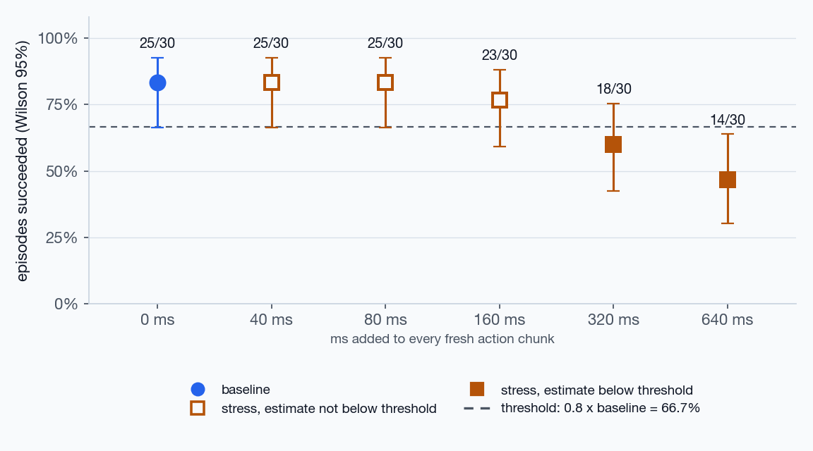
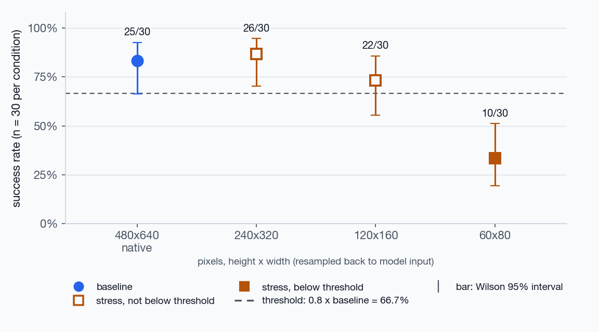
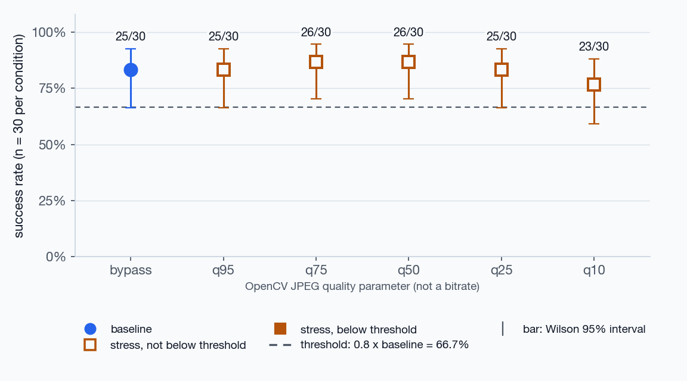
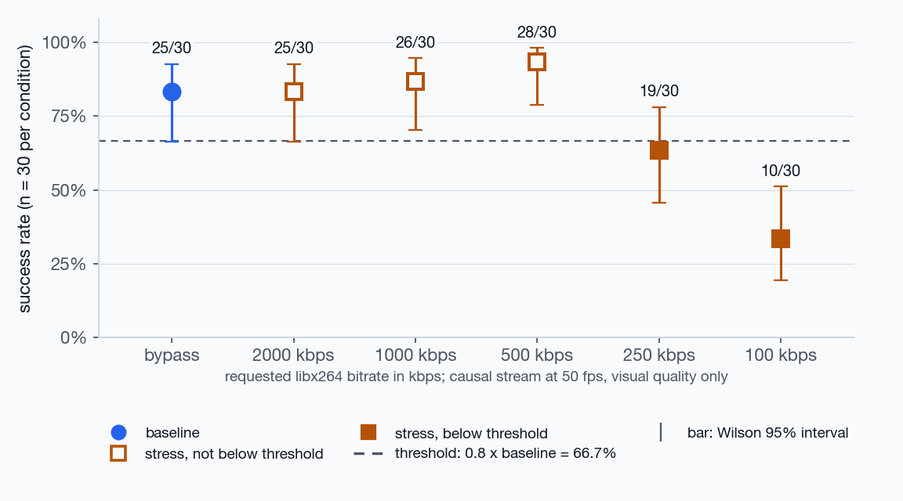
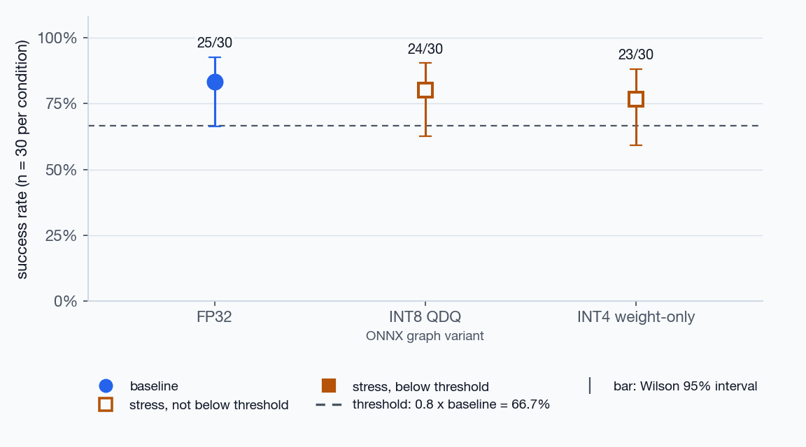
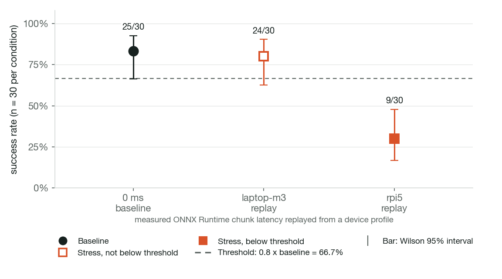
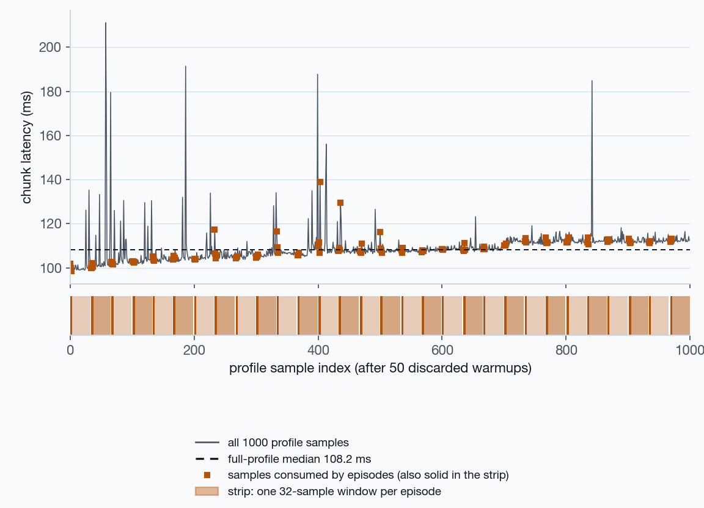
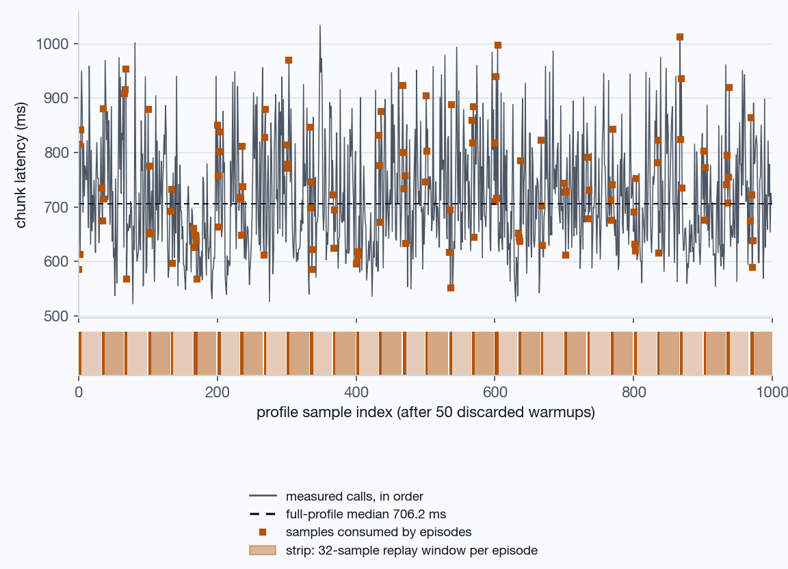

# ACT deployment stress benchmark: cube transfer under isolated stress

810 episode records, 30 paired episodes per condition, env seeds 5000–5029. Exploratory run.

## Summary

**What was evaluated.** One pretrained ACT policy (`lerobot/act_aloha_sim_transfer_cube_human`) on the ALOHA TransferCube task in simulation, run as ONNX Runtime on CPU. No physical robot is involved.

**What changed.** One stress at a time, everything else at baseline:

- Constant added delay: 0 ms (baseline), 40 ms, 80 ms, 160 ms, 320 ms, 640 ms
- Camera resolution: 480x640 native (baseline), 240x320, 120x160, 60x80
- JPEG quality: bypass (baseline), q95, q75, q50, q25, q10
- H.264 bitrate: bypass (baseline), 2000 kbps, 1000 kbps, 500 kbps, 250 kbps, 100 kbps
- Numeric precision: FP32 (baseline), INT8 QDQ, INT4 weight-only
- Device latency replay: 0 ms (baseline), laptop-m3 replay, rpi5 replay

**What the evidence shows.** Paired seeds: every condition faces the same episodes as the baseline.

- Baseline (ONNX FP32, native image, 0 ms delay): 25/30 (83.3%; Wilson 95% 66.4% to 92.7%).
- Constant added delay: first grid point below 0.8 x baseline is 320 ms at 18/30 (interval includes threshold).
- Camera resolution: first grid point below 0.8 x baseline is 60x80 at 10/30.
- JPEG quality: no condition fell below 0.8 x baseline.
- H.264 bitrate: first grid point below 0.8 x baseline is 250 kbps at 19/30 (interval includes threshold).
- Numeric precision (categorical comparison, no ordering) against 0.8 x baseline: INT8 QDQ 24/30 not below; INT4 weight-only 23/30 not below.
- Device latency replay (categorical comparison, no ordering) against 0.8 x baseline: laptop-m3 replay 24/30 not below; rpi5 replay 9/30 below.

> Exploratory simulation run with 30 paired episodes per condition. Intervals are wide, the results have not been confirmed with fresh seeds, and a grid point below the threshold is not an exact boundary. The rpi5 replay reflects one throttled Pi state.

## Validation, errors and caveats

- Errors: 0 runtime errors or policy failures in 810 episode records. Outcomes: 601 success, 209 time_limit_truncation.
- Unsupported conditions: none skipped. INT8 export status is 'ok' and the INT8 graph ran in every planned episode. The INT8 graph has no FP32 numerical-parity requirement; see the provenance section for its recorded chunk error.
- INT4 weight-only: 29 of 41 MatMul nodes are stored as 4-bit blocks (61.6% of weight parameters); Conv, Gemm, and activation-by-activation MatMul stay FP32. Weights are dequantized and computed in float (accuracy_level=0). Recorded chunk error versus ONNX FP32: max abs 0.1459382176399231, mean abs 0.006009796475399936. This is not a full-model INT4 result and no INT4 device timing exists.
- H.264 bitrate axis: frames are encoded and decoded inside the same control step; no codec, transport, or jitter-buffer delay is simulated. The delay axis measures latency separately and the effects are not additive. The stream is ABR, so measured kbps can differ from the request (largest overshoot in these rows: +118.2 kbps). Encoder identity: PyAV 18.1.0, libavcodec [62, 28, 102], preset=veryfast, gop=30, tune=zerolatency.
- Baseline strength: 25/30 (83.3%) against the project floor of 0.5. The baseline is not weak by that floor.
- Sample size: 30 paired episodes per condition. Intervals are wide; the run is exploratory and does not locate an exact boundary.
- Unresolved threshold comparisons (Wilson interval includes the threshold; the threshold is estimated from the same baseline, so this overlap is not a paired significance test): Constant added delay: 40 ms, 80 ms, 160 ms, 320 ms; Camera resolution: 120x160; JPEG quality: q95, q25, q10; H.264 bitrate: 2000 kbps, 250 kbps; Numeric precision: INT8 QDQ, INT4 weight-only; Device latency replay: laptop-m3 replay.
- Resolution ordering: the saved summary stored the same ordered value for every resolution, so conditions are ordered by plan order (native, 240x320, 120x160, 60x80), which is mild to severe.
- Pi 5 timings were captured while throttling was reported in 304 of 393 telemetry samples; cooling and power were not recorded.

## Constant added delay

Stress variable: ms added to every fresh action chunk.



| Condition | Success | Rate | Wilson 95% | Status | Paired with baseline |
| --- | ---: | ---: | ---: | --- | --- |
| 0 ms (baseline) | 25/30 | 83.3% | 66.4% to 92.7% | ◆ baseline | reference |
| 40 ms | 25/30 | 83.3% | 66.4% to 92.7% | ○ not below threshold; interval spans threshold | lost 0; gained 0; both succeeded 25; neither 5 |
| 80 ms | 25/30 | 83.3% | 66.4% to 92.7% | ○ not below threshold; interval spans threshold | lost 0; gained 0; both succeeded 25; neither 5 |
| 160 ms | 23/30 | 76.7% | 59.1% to 88.2% | ○ not below threshold; interval spans threshold | lost 4; gained 2; both succeeded 21; neither 3 |
| 320 ms | 18/30 | 60.0% | 42.3% to 75.4% | ▼ below threshold; interval spans threshold | lost 9; gained 2; both succeeded 16; neither 3 |
| 640 ms | 14/30 | 46.7% | 30.2% to 63.9% | ▼ below threshold | lost 13; gained 2; both succeeded 12; neither 3 |

Saved summary: on this exploratory grid the first point below threshold is 320 ms; the observed crossing lies between 160 ms and 320 ms. Observed interval only; not an interpolated exact boundary.

Per-seed outcomes (● success, ○ none, ▼ lost, ▲ gained):

```
0 ms              ●●●●●●●○●○●●●●●●●●●○●●●○●●●○●●
40 ms             ●●●●●●●○●○●●●●●●●●●○●●●○●●●○●●
80 ms             ●●●●●●●○●○●●●●●●●●●○●●●○●●●○●●
160 ms            ●●●▼●●●○●▲●●●●●●●●▼○●▼●▲▼●●○●●
320 ms            ●●●▼●●▼▲●○●●●▼▼●●▼▼○●▼●○▼●●▲▼●
640 ms            ▼●▼▼●▼▼○●○▼●●▼▼●●▼●○●▼●▲▼●▼▲●▼
```

## Camera resolution

Stress variable: pixels, height x width (resampled back to model input).



| Condition | Success | Rate | Wilson 95% | Status | Paired with baseline |
| --- | ---: | ---: | ---: | --- | --- |
| 480x640 native (baseline) | 25/30 | 83.3% | 66.4% to 92.7% | ◆ baseline | reference |
| 240x320 | 26/30 | 86.7% | 70.3% to 94.7% | ○ not below threshold | lost 3; gained 4; both succeeded 22; neither 1 |
| 120x160 | 22/30 | 73.3% | 55.6% to 85.8% | ○ not below threshold; interval spans threshold | lost 6; gained 3; both succeeded 19; neither 2 |
| 60x80 | 10/30 | 33.3% | 19.2% to 51.2% | ▼ below threshold | lost 17; gained 2; both succeeded 8; neither 3 |

Saved summary: on this exploratory grid the first point below threshold is 60x80; the observed crossing lies between 120x160 and 60x80. Observed interval only; not an interpolated exact boundary.

Per-seed outcomes (● success, ○ none, ▼ lost, ▲ gained):

```
480x640 native    ●●●●●●●○●○●●●●●●●●●○●●●○●●●○●●
240x320           ●●●●▼●●○●▲●●●▼●●●●●▲▼●●▲●●●▲●●
120x160           ●●●▼▼●▼○●▲●●●▼●●●●●○●●▼▲●●●▲▼●
60x80             ●●▼▼▼▼●▲▼○▼●▼▼●▼▼▼▼○▼●▼○▼●●▲▼▼
```

## JPEG quality

Stress variable: OpenCV JPEG quality parameter (not a bitrate).



| Condition | Success | Rate | Wilson 95% | Status | Paired with baseline |
| --- | ---: | ---: | ---: | --- | --- |
| bypass (baseline) | 25/30 | 83.3% | 66.4% to 92.7% | ◆ baseline | reference |
| q95 | 25/30 | 83.3% | 66.4% to 92.7% | ○ not below threshold; interval spans threshold | lost 1; gained 1; both succeeded 24; neither 4 |
| q75 | 26/30 | 86.7% | 70.3% to 94.7% | ○ not below threshold | lost 2; gained 3; both succeeded 23; neither 2 |
| q50 | 26/30 | 86.7% | 70.3% to 94.7% | ○ not below threshold | lost 3; gained 4; both succeeded 22; neither 1 |
| q25 | 25/30 | 83.3% | 66.4% to 92.7% | ○ not below threshold; interval spans threshold | lost 4; gained 4; both succeeded 21; neither 1 |
| q10 | 23/30 | 76.7% | 59.1% to 88.2% | ○ not below threshold; interval spans threshold | lost 7; gained 5; both succeeded 18; neither 0 |

Saved summary: no condition fell below the threshold within the tested range.

Per-seed outcomes (● success, ○ none, ▼ lost, ▲ gained):

```
bypass            ●●●●●●●○●○●●●●●●●●●○●●●○●●●○●●
q95               ●●●●●●●○●▲●●●●●●●▼●○●●●○●●●○●●
q75               ●●●●●●●▲●▲▼●●●●●●▼●○●●●○●●●▲●●
q50               ●●●●▼●●▲●▲●●●●●●●▼●○●●●▲▼●●▲●●
q25               ●●●●▼●●▲●▲●●●●●●●▼●○●●●▲●●▼▲▼●
q10               ●●●▼●●▼▲●▲▼▼●▼▼●▼●●▲●●●▲●●●▲●●
```

## H.264 bitrate

Stress variable: requested libx264 bitrate in kbps; causal stream at 50 fps, visual quality only.



| Condition | Success | Rate | Wilson 95% | Status | Paired with baseline |
| --- | ---: | ---: | ---: | --- | --- |
| bypass (baseline) | 25/30 | 83.3% | 66.4% to 92.7% | ◆ baseline | reference |
| 2000 kbps | 25/30 | 83.3% | 66.4% to 92.7% | ○ not below threshold; interval spans threshold | lost 4; gained 4; both succeeded 21; neither 1 |
| 1000 kbps | 26/30 | 86.7% | 70.3% to 94.7% | ○ not below threshold | lost 2; gained 3; both succeeded 23; neither 2 |
| 500 kbps | 28/30 | 93.3% | 78.7% to 98.2% | ○ not below threshold | lost 1; gained 4; both succeeded 24; neither 1 |
| 250 kbps | 19/30 | 63.3% | 45.5% to 78.1% | ▼ below threshold; interval spans threshold | lost 9; gained 3; both succeeded 16; neither 2 |
| 100 kbps | 10/30 | 33.3% | 19.2% to 51.2% | ▼ below threshold | lost 15; gained 0; both succeeded 10; neither 5 |

| Condition | Requested kbps | Measured kbps (median, min-max) | Mean encoded bytes / frame | Total encoded MB |
| --- | ---: | ---: | ---: | ---: |
| bypass (baseline) | — | — | — | — |
| 2000 kbps | 2000.0 | 2081.3 (2050.4-2118.2) | 5204.5 | 48.867 |
| 1000 kbps | 1000.0 | 1043.2 (998.2-1059.1) | 2600.4 | 23.996 |
| 500 kbps | 500.0 | 516.8 (503.7-528.0) | 1291.9 | 11.096 |
| 250 kbps | 250.0 | 254.3 (239.2-262.6) | 631.3 | 6.103 |
| 100 kbps | 100.0 | 100.0 (93.8-104.4) | 249.7 | 2.662 |

Saved summary: on this exploratory grid the first point below threshold is 250 kbps; the observed crossing lies between 500 kbps and 250 kbps. Observed interval only; not an interpolated exact boundary.

Per-seed outcomes (● success, ○ none, ▼ lost, ▲ gained):

```
bypass            ●●●●●●●○●○●●●●●●●●●○●●●○●●●○●●
2000 kbps         ●●▼●▼●●▲●○●●●●●●●▼●▲●●▼▲●●●▲●●
1000 kbps         ●●●●●●●▲●○●●●●●●●▼●○●●●▲▼●●▲●●
500 kbps          ●●●●▼●●▲●○●●●●●●●●●▲●●●▲●●●▲●●
250 kbps          ●●●●●▼●▲●▲▼●●▼●●▼▼▼○▼●▼○●●▼▲●●
100 kbps          ●●▼▼●●●○●○▼▼●▼●●▼▼▼○▼▼▼○●▼▼○▼▼
```

## Numeric precision

Stress variable: ONNX graph variant.



| Condition | Success | Rate | Wilson 95% | Status | Paired with baseline |
| --- | ---: | ---: | ---: | --- | --- |
| FP32 (baseline) | 25/30 | 83.3% | 66.4% to 92.7% | ◆ baseline | reference |
| INT8 QDQ | 24/30 | 80.0% | 62.7% to 90.5% | ○ not below threshold; interval spans threshold | lost 4; gained 3; both succeeded 21; neither 2 |
| INT4 weight-only | 23/30 | 76.7% | 59.1% to 88.2% | ○ not below threshold; interval spans threshold | lost 3; gained 1; both succeeded 22; neither 4 |

Categorical comparison against the baseline: the conditions have no order, so no breakpoint is estimated. No condition's point estimate is below the threshold.

Per-seed outcomes (● success, ○ none, ▼ lost, ▲ gained):

```
FP32              ●●●●●●●○●○●●●●●●●●●○●●●○●●●○●●
INT8 QDQ          ●●▼●●●●○●▲●●▼●●●●▼▼▲●●●▲●●●○●●
INT4 weight-only  ●●▼●●●●○●▲▼●●●●●●●▼○●●●○●●●○●●
```

## Device latency replay

Stress variable: measured ONNX Runtime chunk latency replayed from a device profile.



| Condition | Success | Rate | Wilson 95% | Status | Paired with baseline |
| --- | ---: | ---: | ---: | --- | --- |
| 0 ms (baseline) | 25/30 | 83.3% | 66.4% to 92.7% | ◆ baseline | reference |
| laptop-m3 replay | 24/30 | 80.0% | 62.7% to 90.5% | ○ not below threshold; interval spans threshold | lost 2; gained 1; both succeeded 23; neither 4 |
| rpi5 replay | 9/30 | 30.0% | 16.7% to 47.9% | ▼ below threshold | lost 17; gained 1; both succeeded 8; neither 4 |

No saved experiment summary exists for this axis; counts, intervals, and paired tables are derived by this report from the episode records. Categorical comparison against the baseline: the conditions have no order, so no breakpoint is estimated. Point estimate below threshold: rpi5 replay.

Per-seed outcomes (● success, ○ none, ▼ lost, ▲ gained):

```
0 ms              ●●●●●●●○●○●●●●●●●●●○●●●○●●●○●●
laptop-m3 replay  ●●●▼●●●○●▲●●●●●●●●●○●▼●○●●●○●●
rpi5 replay       ▼▼▼▼●▼▼○●○▼●●▼▼●▼▼▼○●▼●○▼●▼▲▼▼
```

## Device timing

### laptop-m3



| Set | n | median ms | p95 ms | p99 ms |
| --- | ---: | ---: | ---: | ---: |
| full profile | 1000 | 108.2 | 114.9 | 135.0 |
| replay windows | 960 | 108.2 | 114.8 | 133.5 |
| consumed | 105 | 108.1 | 113.9 | 129.2 |

### rpi5



| Set | n | median ms | p95 ms | p99 ms |
| --- | ---: | ---: | ---: | ---: |
| full profile | 1000 | 706.2 | 917.1 | 972.6 |
| replay windows | 960 | 705.0 | 916.1 | 973.2 |
| consumed | 120 | 733.2 | 923.8 | 991.3 |

## Checks

- pass: packaged files match manifest sha256 (77 files hashed)
- pass: episode rows: planned seeds, policy RNG seeds, success flag vs outcome (810 rows)
- pass: no runtime errors or policy failures in any episode (outcomes: success, time_limit_truncation)
- pass: displayed counts: every axis lists each planned condition once (28 condition rows)
- pass: v0.1_full_latency: saved summary counts and Wilson intervals equal episode records (6 conditions)
- pass: v0.1_full_resolution: saved summary counts and Wilson intervals equal episode records (4 conditions)
- pass: v0.1_full_jpeg: saved summary counts and Wilson intervals equal episode records (6 conditions)
- pass: v0.1_full_h264: saved summary counts and Wilson intervals equal episode records (6 conditions)
- pass: v0.1_full_precision: saved summary counts and Wilson intervals equal episode records (3 conditions)
- pass: shared baseline outcomes equal the latency_ms_0 condition seed by seed (120 referenced rows; differing: [])
- pass: latency axis: recorded constant delay equals the condition label (all episodes)
- pass: device replay: windows follow the locked design and consumed delays equal profile samples (2 profiles)
- pass: device profiles were measured on the locked FP32 graph (fp32 sha256 27bf9278030e)
- pass: INT4 episodes complete with no policy_failed (finite closed-loop outputs) (106 INT4 inference calls)
- pass: H.264 rows: measured kbps matches bytes/frames at 50 fps; frames=n_control_steps; zero holds; first-frame keyframe (150 H.264 episodes)

## Condition IDs

| Axis | Condition | ID |
| --- | --- | --- |
| Constant added delay | 0 ms | `latency_ms_0` |
| Constant added delay | 40 ms | `latency_ms_40` |
| Constant added delay | 80 ms | `latency_ms_80` |
| Constant added delay | 160 ms | `latency_ms_160` |
| Constant added delay | 320 ms | `latency_ms_320` |
| Constant added delay | 640 ms | `latency_ms_640` |
| Camera resolution | 480x640 native | `resolution_native` |
| Camera resolution | 240x320 | `resolution_capture_240x320` |
| Camera resolution | 120x160 | `resolution_capture_120x160` |
| Camera resolution | 60x80 | `resolution_capture_60x80` |
| JPEG quality | bypass | `jpeg_bypass` |
| JPEG quality | q95 | `jpeg_q95` |
| JPEG quality | q75 | `jpeg_q75` |
| JPEG quality | q50 | `jpeg_q50` |
| JPEG quality | q25 | `jpeg_q25` |
| JPEG quality | q10 | `jpeg_q10` |
| H.264 bitrate | bypass | `h264_bypass` |
| H.264 bitrate | 2000 kbps | `h264_2000kbps` |
| H.264 bitrate | 1000 kbps | `h264_1000kbps` |
| H.264 bitrate | 500 kbps | `h264_500kbps` |
| H.264 bitrate | 250 kbps | `h264_250kbps` |
| H.264 bitrate | 100 kbps | `h264_100kbps` |
| Numeric precision | FP32 | `precision_onnx_fp32` |
| Numeric precision | INT8 QDQ | `precision_int8` |
| Numeric precision | INT4 weight-only | `precision_int4_weight_only` |
| Device latency replay | 0 ms | `latency_ms_0` |
| Device latency replay | laptop-m3 replay | `device_profile_laptop-m3_fp32` |
| Device latency replay | rpi5 replay | `device_profile_rpi5_fp32` |
