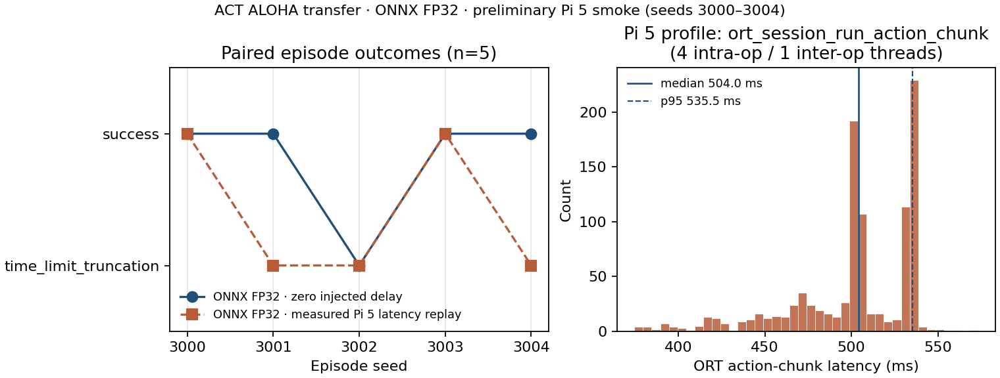

# ACT ALOHA transfer — Raspberry Pi 5 latency replay smoke (**preliminary**)

**Status: preliminary.** Small simulation smoke only. Not a real-robot task
test. No established latency breakpoint. Power supply and cooling unknown;
Pi temperature recorded at **84.25°C**; throttling **unknown**.

## Headline result

Paired seeds **3000–3004** (five episodes per condition), same ONNX FP32 graph:

| Condition | Label | Success | Runtime errors |
| --- | --- | --- | --- |
| Baseline | ONNX FP32 · zero injected delay | **4/5** | 0 |
| Pi 5 replay | ONNX FP32 · measured Pi 5 latency replay | **2/5** | 0 |

Replay uses ordered `ort_session_run_action_chunk` timings (4 intra-op / 1
inter-op threads), applied at fresh chunk inference with `discard_stale`.

## Visualization

- Figure (PNG/PDF): [figures/paired_outcomes_and_latency.png](figures/paired_outcomes_and_latency.png)
- Seed 3001 side-by-side (reproduces baseline **success** vs replay **time_limit_truncation**):
  - [media/seed3001_side_by_side.mp4](media/seed3001_side_by_side.mp4)
  - [media/seed3001_side_by_side.gif](media/seed3001_side_by_side.gif)
  - Emitted latencies: [media/seed3001_replay_latencies.json](media/seed3001_replay_latencies.json)

Videos are simulation footage of ONNX FP32 control, **not** INT4 and **not**
physical-robot recordings.

## Evidence index (relative paths)

| Item | Path |
| --- | --- |
| Methodology note | [methodology.md](methodology.md) |
| Curated summary | [evidence/summary.json](evidence/summary.json) |
| Export manifest | [evidence/export/export_manifest.json](evidence/export/export_manifest.json) |
| Accepted validation v2 | [evidence/export/export_validation_v2.json](evidence/export/export_validation_v2.json) |
| Closed-loop diagnosis (v2 support) | [evidence/diagnostics/closed_loop_diagnosis.json](evidence/diagnostics/closed_loop_diagnosis.json) |
| Pi profile (raw timings) | [evidence/profiles/act_aloha_transfer__onnx_fp32__rpi5__27bf9278030e.json](evidence/profiles/act_aloha_transfer__onnx_fp32__rpi5__27bf9278030e.json) |
| Baseline run | [evidence/runs/baseline/](evidence/runs/baseline/) |
| Pi replay run | [evidence/runs/rpi5-replay/](evidence/runs/rpi5-replay/) |

Original sources remain under `artifacts/`, `profiles/rpi5/`, and
`outputs/manual/`; this directory is a curated copy for review.

## Binding hashes

- Model SHA-256: `27bf9278030e4d2357f64aa55174f5718ac43c8202c07a22ceac2eef7ecc2eba`
- Eval corpus SHA-256: `f9559ac9037385d302a99c6ec16a5327407fedd4aa3643eba2eaa9ebe8d787ea`
- Validation v2 recorded code revision: `e8255f0897c69e97551fe62912bcafc1b14d7d2b` (`code_dirty=true` at write time)
