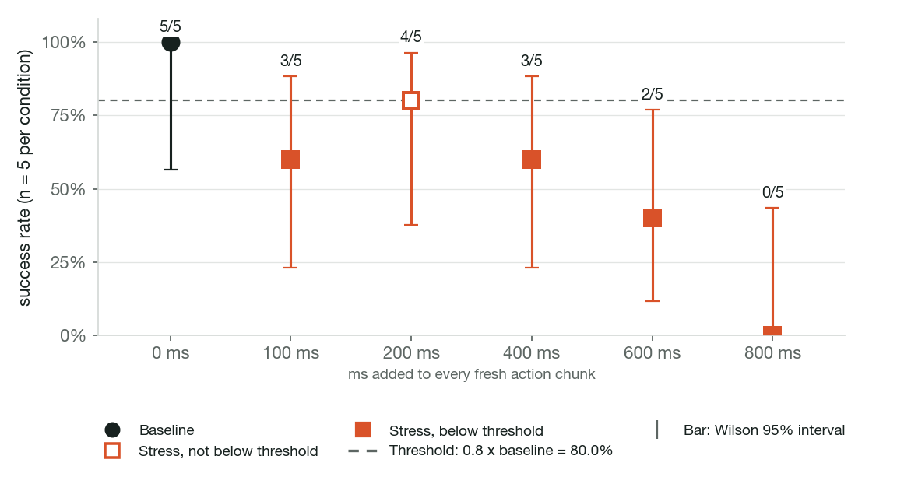
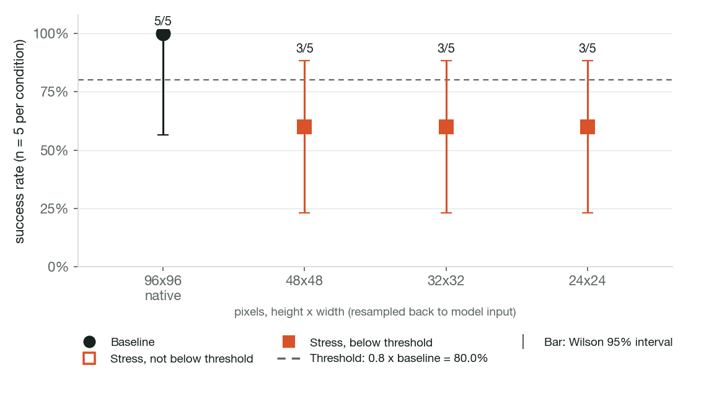
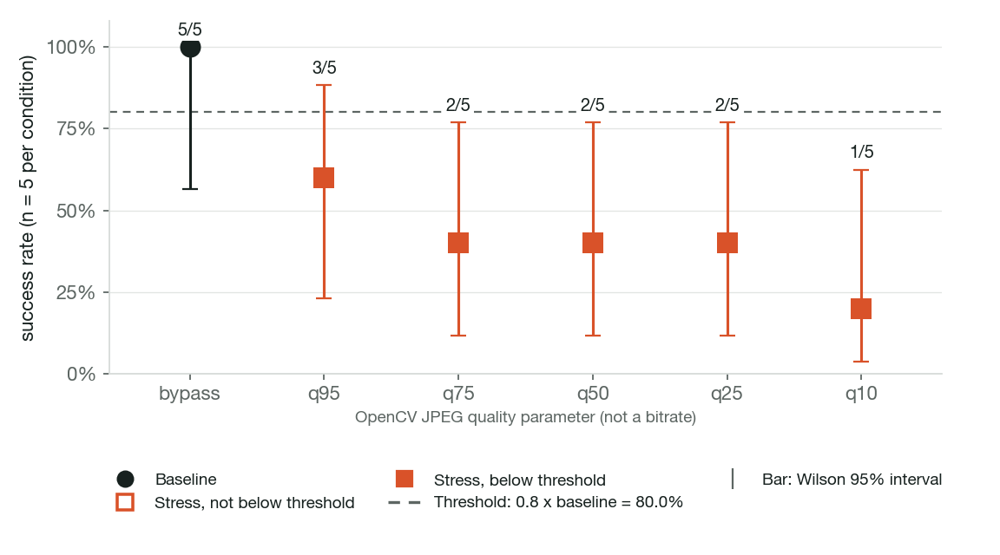

# Diffusion Policy on PushT under stress

80 episode records, 5 paired episodes per condition, env seeds 6000 to 6004.

## Summary

One pretrained Diffusion Policy (`lerobot/diffusion_pusht` at revision `202c8695947a458d8ce08ce1c0219f2588d60b33`) on PushT in simulation, run as PyTorch FP32 on CPU. Simulation only.

Exploratory run with 5 paired episodes per condition; not confirmed with fresh seeds.

- Baseline (PyTorch FP32, native image, 0 ms delay): 5/5 (100.0%; Wilson 95% 56.6% to 100.0%).
- Constant added delay: first tested point below threshold is 100 ms at 3/5 (interval includes threshold).
- Camera resolution: first tested point below threshold is 48x48 at 3/5 (interval includes threshold).
- JPEG quality: first tested point below threshold is q95 at 3/5 (interval includes threshold).

## Validation, errors and caveats

- Errors: 0 runtime errors or policy failures in 80 episode records. Outcomes: 46 success, 34 time_limit_truncation.
- Baseline 5/5 (100.0%), above the 0.5 floor.
- Sample size: 5 paired episodes per condition. A grid point below the threshold is not an interpolated exact boundary.
- "Interval spans threshold" means the Wilson interval overlaps the threshold; that is an interval overlap, not a paired significance test. Conditions: Constant added delay: 100 ms, 200 ms, 400 ms; Camera resolution: 48x48, 32x32, 24x24; JPEG quality: q95.
- 800 ms: the delay is at least one chunk span (800 ms), every action arrived stale and no policy action was applied, so its successes reflect holding the start position.
- Resolution ordering: the saved summary stored the same ordered value for every resolution, so conditions are ordered by plan order (native, 240x320, 120x160, 60x80), which is mild to severe.
- Model card success is 65.4% over 500 episodes; this run's baseline is 5/5. Stated as context, not a reproduction.
- Delay is injected in simulated time; host generation time is not added.
- No ONNX, quantization, H.264 or device replay for this candidate ([methodology](../../../../docs/methodology.md)).

## Constant added delay

Stress variable: ms added to every fresh action chunk.



| Condition | Success | Rate | Wilson 95% | Status | Paired with baseline |
| --- | ---: | ---: | ---: | --- | --- |
| 0 ms (baseline) | 5/5 | 100.0% | 56.6% to 100.0% | baseline | reference |
| 100 ms | 3/5 | 60.0% | 23.1% to 88.2% | below (interval spans threshold) | lost 2; gained 0; both succeeded 3; neither 0 |
| 200 ms | 4/5 | 80.0% | 37.6% to 96.4% | not below (interval spans threshold) | lost 1; gained 0; both succeeded 4; neither 0 |
| 400 ms | 3/5 | 60.0% | 23.1% to 88.2% | below (interval spans threshold) | lost 2; gained 0; both succeeded 3; neither 0 |
| 600 ms | 2/5 | 40.0% | 11.8% to 76.9% | below | lost 3; gained 0; both succeeded 2; neither 0 |
| 800 ms | 0/5 | 0.0% | 0.0% to 43.4% | below | lost 5; gained 0; both succeeded 0; neither 0 |

First tested point below threshold: 100 ms (between 0 ms and 100 ms).

Per-seed outcomes (● success, ○ none, ▼ lost, ▲ gained):

```
0 ms              ●●●●●
100 ms            ▼●●●▼
200 ms            ●●▼●●
400 ms            ▼●●▼●
600 ms            ▼▼●▼●
800 ms            ▼▼▼▼▼
```

## Camera resolution

Stress variable: pixels, height x width (resampled back to model input).



| Condition | Success | Rate | Wilson 95% | Status | Paired with baseline |
| --- | ---: | ---: | ---: | --- | --- |
| 96x96 native (baseline) | 5/5 | 100.0% | 56.6% to 100.0% | baseline | reference |
| 48x48 | 3/5 | 60.0% | 23.1% to 88.2% | below (interval spans threshold) | lost 2; gained 0; both succeeded 3; neither 0 |
| 32x32 | 3/5 | 60.0% | 23.1% to 88.2% | below (interval spans threshold) | lost 2; gained 0; both succeeded 3; neither 0 |
| 24x24 | 3/5 | 60.0% | 23.1% to 88.2% | below (interval spans threshold) | lost 2; gained 0; both succeeded 3; neither 0 |

First tested point below threshold: 48x48 (between 480x640 native and 48x48).

Per-seed outcomes (● success, ○ none, ▼ lost, ▲ gained):

```
96x96 native      ●●●●●
48x48             ▼▼●●●
32x32             ▼●●●▼
24x24             ▼●●●▼
```

## JPEG quality

Stress variable: OpenCV JPEG quality parameter (not a bitrate).



| Condition | Success | Rate | Wilson 95% | Status | Paired with baseline |
| --- | ---: | ---: | ---: | --- | --- |
| bypass (baseline) | 5/5 | 100.0% | 56.6% to 100.0% | baseline | reference |
| q95 | 3/5 | 60.0% | 23.1% to 88.2% | below (interval spans threshold) | lost 2; gained 0; both succeeded 3; neither 0 |
| q75 | 2/5 | 40.0% | 11.8% to 76.9% | below | lost 3; gained 0; both succeeded 2; neither 0 |
| q50 | 2/5 | 40.0% | 11.8% to 76.9% | below | lost 3; gained 0; both succeeded 2; neither 0 |
| q25 | 2/5 | 40.0% | 11.8% to 76.9% | below | lost 3; gained 0; both succeeded 2; neither 0 |
| q10 | 1/5 | 20.0% | 3.6% to 62.4% | below | lost 4; gained 0; both succeeded 1; neither 0 |

First tested point below threshold: q95 (between bypass and q95).

Per-seed outcomes (● success, ○ none, ▼ lost, ▲ gained):

```
bypass            ●●●●●
q95               ●●▼▼●
q75               ●▼▼●▼
q50               ●●▼▼▼
q25               ▼▼●●▼
q10               ●▼▼▼▼
```

## Action-generation timing

| Device | n | median ms | p95 ms | p99 ms | max ms |
| --- | ---: | ---: | ---: | ---: | ---: |
| laptop-m3 | 50 | 13433.8 | 32554.3 | 48941.5 | 49842.4 |

The timed call covers one full generate_actions with all 100 denoising steps on cpu with 4 torch threads.
The measured median is 13433.8 ms; the largest tested delay is 800 ms and the control period is 100 ms.
These timings are not replayed into episodes.

## Checks

- pass: Packaged files match the manifest digests (45 files hashed)
- pass: Episode rows match planned seeds and success flags (80 rows)
- pass: No runtime errors or policy failures in any episode (outcomes: success, time_limit_truncation)
- pass: Every axis lists each planned condition once (16 condition rows)
- pass: v0.1_full_latency saved summary matches episode records (6 conditions)
- pass: v0.1_full_resolution saved summary matches episode records (4 conditions)
- pass: v0.1_full_jpeg saved summary matches episode records (6 conditions)
- pass: Shared baseline outcomes match latency_ms_0 seed by seed (10 referenced rows; differing: [])
- pass: Latency axis recorded delay matches the condition label (all episodes)
- pass: Upstream agreement passed on 5 seeds with bitwise-equal actions and rerun determinism (passed=True; determinism=True)
- pass: Every episode row candidate equals the lock candidate (no pooling) (candidate=diffusion_pusht)
- pass: Timing profile checkpoint hashes equal the lock checkpoint hashes (ok)

## Condition IDs

| Axis | Condition | ID |
| --- | --- | --- |
| Constant added delay | 0 ms | `latency_ms_0` |
| Constant added delay | 100 ms | `latency_ms_100` |
| Constant added delay | 200 ms | `latency_ms_200` |
| Constant added delay | 400 ms | `latency_ms_400` |
| Constant added delay | 600 ms | `latency_ms_600` |
| Constant added delay | 800 ms | `latency_ms_800` |
| Camera resolution | 96x96 native | `resolution_native` |
| Camera resolution | 48x48 | `resolution_capture_48x48` |
| Camera resolution | 32x32 | `resolution_capture_32x32` |
| Camera resolution | 24x24 | `resolution_capture_24x24` |
| JPEG quality | bypass | `jpeg_bypass` |
| JPEG quality | q95 | `jpeg_q95` |
| JPEG quality | q75 | `jpeg_q75` |
| JPEG quality | q50 | `jpeg_q50` |
| JPEG quality | q25 | `jpeg_q25` |
| JPEG quality | q10 | `jpeg_q10` |
